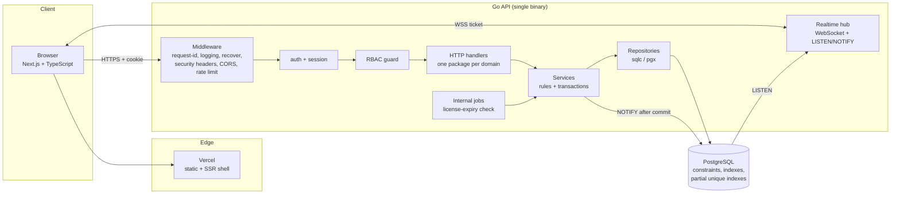
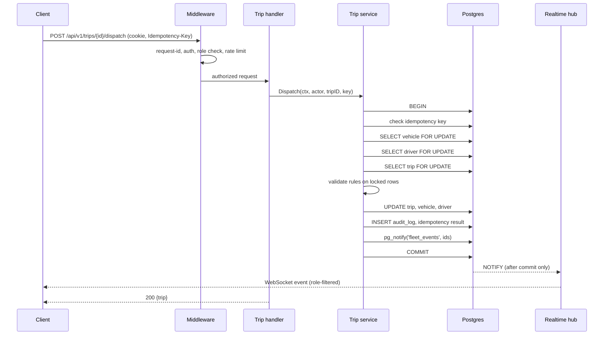
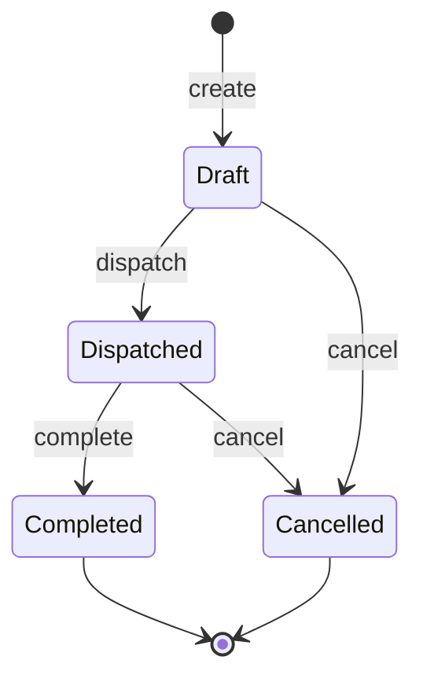
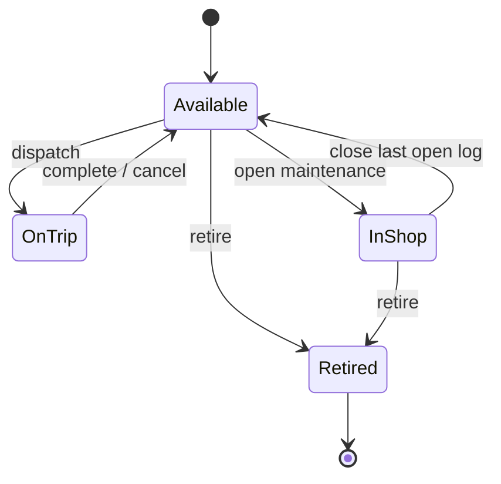
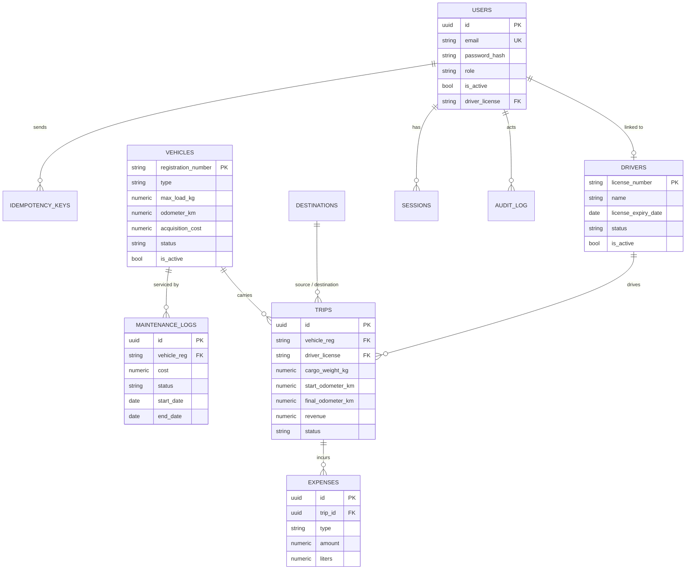
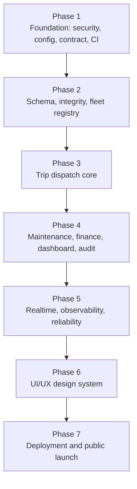
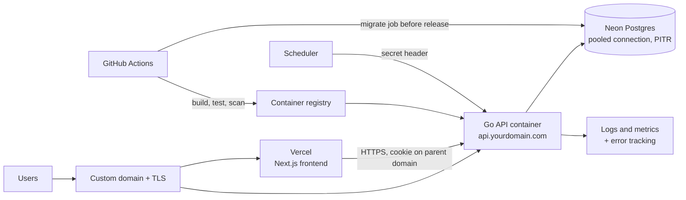

# TransitOps — Go Backend Product Plan

**Audience:** the coding agent that will implement this, and the solo developer who will review it.
**Starting point:** the Go port of the backend exists and the product already works end to end (Go API + Next.js/TypeScript frontend). The port reproduced the Python behavior faithfully, **including its known bugs**.
**Goal:** turn a working prototype into a secure, correct, observable, product-grade fleet operations platform, then give it a professional UI and launch it publicly.
**Rule of the plan:** each phase is built fully, tested, debugged, and *used* before the next one starts. UI/UX and deployment are the last two phases on purpose.

> **Honesty note for the agent.** This plan was written without reading the Go code. Package names and file paths below are the *target* layout. Phase 1, Task 1.0 is to inventory the real code and reconcile it with this plan. Where the real code differs, report the difference and follow the plan's intent, not its paths.

---

## 1. Product definition

TransitOps is a fleet operations platform. A company registers vehicles and drivers, dispatches trips, tracks maintenance and costs, and watches live operational KPIs.

| Role | Can do |
|---|---|
| **Admin** | Everything, including user management and audit log |
| **Fleet Manager** | Vehicles, drivers, destinations, trips, maintenance, expenses, dashboard |
| **Driver** | See assigned trips; complete or cancel **own** trips; read-only fleet lookup |
| **Safety Officer** | Driver records, license status, suspend/reinstate drivers; read-only trips |
| **Financial Analyst** | Expenses, finance summary, dashboard, CSV export; read-only trips |

Core workflows: **Register assets → Dispatch trip → Complete/Cancel → Log expenses → Maintain vehicles → Review KPIs.**

---

## 2. Gaps this plan closes

These come from the earlier audit of the Python prototype. The Go port inherited all of them. Each gap is mapped to the phase that closes it.

| ID | Sev | Gap | Phase |
|---|---|---|---|
| S-01 | P0 | Public register endpoint accepts `role: Admin` | 1 |
| S-02 | P0 | Login accepts plaintext stored passwords; seed has shared plaintext passwords | 1 |
| S-03 | P0 | Default/weak signing secret allowed | 1 |
| S-04 | P1 | Any role can complete/cancel any trip | 3 |
| S-05 | P1 | WebSocket has no authentication | 5 |
| S-06 | P1 | No login throttling; account enumeration | 1 |
| S-07 | P1 | Vulnerable frontend dependencies (`next`) | 1 |
| S-08 | P2 | CORS wildcard with credentials | 1 |
| S-09 | P2 | Token in `localStorage` | 1 |
| S-10 | P2 | No security headers | 1 |
| S-11 | P2 | Over-broad PII/financial reads | 4 |
| D-01 | P1 | Dispatch is check-then-write; double-booking under concurrency (reproduced) | 3 |
| D-02 | P1 | Maintenance un-retires Retired vehicles; multiple open logs | 4 |
| D-03 | P1 | Ignored/missing validation; free-form enums; negative numbers | 2 |
| D-04 | P1 | `PUT` can set any status, bypassing the state machine | 2 |
| D-05 | P1 | Schemas diverged; Postgres had no CHECK constraints | 2 |
| D-06 | P2 | Hard deletes cause FK errors / destroy history | 2 |
| D-08 | P2 | Draft lifecycle unreachable; `pending_trips` KPI dead | 3 |
| D-09 | P2 | KPI math counts cancelled/draft trips; distance uses planned | 4 |
| D-10 | P2 | No idempotency on POST endpoints | 3, 4 |
| P-01 | P1 | Dashboard N+1 (measured: 7 req/s, p95 8.2 s at 32 clients) | 4 |
| P-05 | P2 | No pagination | 2 |
| R-01 | P1 | WebSocket broker is per-process | 5 |
| R-02 | P1 | No backup/restore | 7 |
| O-01 | P1 | No logs/metrics/health | 5 |
| O-02 | P2 | No audit trail | 4 |
| T-01 | P1 | Almost no tests | every phase |
| V-xx | P2 | Weak CI, no scanning | 1 |

---

## 3. Target architecture

### 3.1 Principles
1. **Modular monolith.** One Go binary, one Postgres. No microservices, Kubernetes, Kafka, or Redis.
2. **The database enforces invariants; the service layer orchestrates.** Constraints and partial unique indexes are the backstop for every rule that matters.
3. **Contract first.** One `openapi.yaml` is the source of truth; Go server types and TypeScript client types are generated from it.
4. **Everything observable.** Request ID, structured logs, metrics, health probes.
5. **Boring technology.** Standard library first; each dependency must justify itself.

### 3.2 System diagram



### 3.3 Layering rules (enforced by review and a lint rule)
- `handler` parses and validates input, calls **one** service method, maps the result to HTTP. No SQL, no business rules.
- `service` owns transactions, business rules, authorization-by-resource, audit writes, and event publishing. No `net/http` types.
- `repo` runs SQL only. It receives a `pgx.Tx` or pool through a small interface (`DBTX`).
- Packages never import "upward" (repo → service → handler). Domains talk to each other through service interfaces, never through each other's repos.

### 3.4 Dispatch request lifecycle



### 3.5 State machines





Drivers: `Available ↔ On Trip` (system only); `Available ↔ Off Duty` (Fleet Manager); `Suspended` set/cleared only by Safety Officer or Admin. **No endpoint accepts `status` in a generic update body.**

### 3.6 Data model



Schema rules (all in migrations, not application code):
- `CHECK` on every enum column, every amount (`>= 0`), `cargo_weight > 0`, `source_id <> destination_id`, `end_date >= start_date`.
- `NUMERIC(12,2)` for money, `NUMERIC(10,1)` for km/kg, `DATE` for dates, `TIMESTAMPTZ` for instants, `created_at`/`updated_at` everywhere.
- Foreign keys use `ON DELETE RESTRICT`. Vehicles and drivers are **soft-deleted** (`is_active=false`).
- **Partial unique indexes** (the real fix for double-booking):
  - `trips(vehicle_reg) WHERE status='Dispatched'`
  - `trips(driver_license) WHERE status='Dispatched'`
  - `maintenance_logs(vehicle_reg) WHERE status='Open'`
- Indexes only for known queries: `trips(vehicle_reg)`, `trips(driver_license)`, `trips(status, created_at)`, `expenses(trip_id)`, `maintenance_logs(vehicle_reg)`, `audit_log(entity, entity_id, at)`.

### 3.7 Technology choices (Go)

| Concern | Choice | Why |
|---|---|---|
| Language | Go 1.22+ | Static binary, simple concurrency, fast cold start |
| HTTP | `net/http` + Go 1.22 `ServeMux` patterns (keep whatever router the port used; don't swap it) | Fewer dependencies |
| DB driver/pool | `jackc/pgx/v5` + `pgxpool` | De-facto standard; native `LISTEN/NOTIFY`, batch, tx |
| Queries | **`sqlc`** (SQL files → type-safe Go) | Keeps hand-written SQL (needed for locks/constraints) with compile-time types |
| Migrations | `golang-migrate` (already in the port) | Forward + tested down migrations |
| Money | `shopspring/decimal` in Go, `NUMERIC` in DB | No float rounding |
| Passwords | `argon2id` via `golang.org/x/crypto/argon2` | Modern default; no real users exist, so no legacy hashes to carry |
| Sessions | **Opaque random token**, SHA-256 hash stored in `sessions` table, in `HttpOnly` cookie | Server-side revocation and logout-everywhere; removes the "forged JWT" class of bug |
| WebSocket | `github.com/coder/websocket` | Maintained, context-aware |
| Config | Env parsed into a typed struct, validated at startup (e.g. `caarlos0/env`) | Fail fast |
| Logging | `log/slog` JSON | Standard library |
| Metrics | `prometheus/client_golang` | Standard |
| Errors tracking | Sentry Go SDK (optional) | Low effort |
| Contract | `openapi.yaml` + `oapi-codegen` (server types) + `openapi-typescript` (client types) | One truth for both sides |
| Tests | `testing`, `testify`, `testcontainers-go` (real Postgres), `go test -race` | Concurrency tests must run with the race detector |
| Lint/security | `golangci-lint`, `govulncheck`, `gitleaks` | CI gates |
| Rate limit/lockout | Postgres `login_attempts` table + `x/time/rate` for coarse limits | No Redis needed |
| Frontend tests | Playwright + axe | E2E, visual regression, accessibility |

**Not used:** Redis, Kafka, RabbitMQ, Kubernetes, GraphQL, gRPC, microservices, OpenTelemetry tracing (revisit only if a second service appears).

### 3.8 Target file structure

```
transitops/
├─ api/
│  └─ openapi.yaml                    # single API contract
├─ backend/
│  ├─ cmd/
│  │  ├─ api/main.go                  # wiring only: config → db → services → router → server
│  │  ├─ migrate/main.go              # run migrations (release step)
│  │  ├─ seed/main.go                 # synthetic data; refuses ENV=production
│  │  └─ admin/main.go                # create-admin CLI
│  ├─ internal/
│  │  ├─ config/                      # typed env config, validation
│  │  ├─ platform/
│  │  │  ├─ db/                       # pgxpool, tx helper, DBTX interface
│  │  │  ├─ httpx/                    # JSON helpers, error model, pagination, request-id
│  │  │  ├─ logging/                  # slog setup
│  │  │  ├─ metrics/                  # prometheus registry
│  │  │  └─ clock/                    # injectable time for tests
│  │  ├─ middleware/                  # recover, requestid, logging, secure headers, cors, ratelimit, auth
│  │  ├─ auth/                        # login, sessions, password hashing, lockout
│  │  ├─ rbac/                        # roles, permission matrix, Require(...) guard
│  │  ├─ users/                       # admin user management
│  │  ├─ fleet/
│  │  │  ├─ vehicles/                 # handler.go, service.go, repo.go, model.go, *_test.go
│  │  │  └─ drivers/
│  │  ├─ destinations/
│  │  ├─ trips/                       # dispatch, complete, cancel, suggest, idempotency use
│  │  ├─ maintenance/
│  │  ├─ finance/                     # expenses, per-vehicle cost summary
│  │  ├─ dashboard/                   # KPI queries, CSV export
│  │  ├─ audit/                       # audit writer + reader
│  │  ├─ idempotency/                 # key store + replay logic
│  │  ├─ realtime/                    # hub, tickets, LISTEN/NOTIFY bridge, role filters
│  │  ├─ jobs/                        # license-expiry check (HTTP-triggered)
│  │  └─ health/                      # /healthz, /readyz
│  ├─ db/
│  │  ├─ migrations/                  # 0001_… up/down SQL
│  │  └─ queries/                     # sqlc *.sql per domain
│  ├─ sqlc.yaml
│  ├─ Dockerfile                      # multi-stage, distroless, non-root
│  └─ go.mod
├─ frontend/                          # Next.js + TypeScript
│  └─ src/
│     ├─ app/                         # routes
│     ├─ components/                  # ui/ (design system), layout/, features/
│     ├─ lib/api/                     # generated types + thin typed client
│     ├─ lib/auth/                    # session hook, role gates
│     └─ styles/tokens.css            # design tokens
├─ e2e/                               # Playwright tests
├─ docs/                              # ARCHITECTURE.md, ENV.md, RUNBOOK.md, ADRs/
├─ .github/workflows/                 # ci.yml, security.yml, deploy.yml
└─ docker-compose.yml                 # local Postgres (+ api, web optional)
```

### 3.9 API conventions (apply to every endpoint)
- Prefix `/api/v1`. Breaking changes require `/v2`.
- **One error shape:** `{"error": {"code": "TRIP_VEHICLE_UNAVAILABLE", "message": "…", "request_id": "…", "details": {…}}}`. Stable machine codes; messages for humans.
- Status codes: `400` malformed, `401` unauthenticated, `403` forbidden, `404` not found, `409` conflict (state/uniqueness), `422` validation, `429` rate limited, `5xx` never leaks internals.
- **Lists:** cursor pagination `?limit=25&cursor=…` → `{"items":[…],"next_cursor":"…"}`; `limit` max 100; every list has a deterministic sort.
- Mutations that create or transition state require `Idempotency-Key` (UUID).
- Money and quantities are validated server-side; JSON numbers stay numbers for frontend compatibility.

---

## 4. How the agent must work

1. **One branch per phase** (`phase-1-foundation`, …), branched from the previous phase's merged result.
2. **One commit per task** (`1.3 sessions table + login`). Every commit builds and passes tests.
3. **Read before writing.** Task X.0 of every phase: inventory the current code for that area and write findings to `docs/phase-N-notes.md`.
4. **Tests first for bugs.** For each gap, first add a test that reproduces it (it fails on current code), then fix it.
5. **No scope creep.** Do not start the next phase's work. Do not add dependencies the phase doesn't need; list every dependency added and why.
6. **Phase gate.** A phase is finished only when every item in its *Exit gate* is true and verified with command output, not claims.
7. **Report format after each phase:** commits, test/lint/vuln output, gaps closed (by ID), decisions not covered by the plan, anything not done and why.
8. **Frontend changes** are limited to what the phase's API changes require (until Phase 6).

Dependency order:



---

# PHASE 1 — Foundation: Security, Config, Contract, CI

**Objective:** nobody can take over the system, the app refuses to run misconfigured, errors look the same everywhere, and CI protects every later phase. No new product features.

**Closes:** S-01, S-02, S-03, S-06, S-07, S-08, S-09, S-10, V-xx.

### Tasks
- **1.0 Inventory.** List every route, its role requirement, and every place that reads env vars. Compare to this plan. Write `docs/phase-1-notes.md`.
- **1.1 Config.** Typed config struct validated at startup. Required: `DATABASE_URL`, `SESSION_SECRET` (≥ 32 bytes, rejected if on a known-weak list), `ENV` (`local|production`), `ALLOWED_ORIGINS`, `COOKIE_DOMAIN`. App exits non-zero with a clear message when invalid. No defaults for secrets.
- **1.2 Auth rewrite.**
  - Tables: `users`, `sessions` (`token_hash`, `user_id`, `expires_at`, `created_at`, `last_seen_at`, `ip`, `user_agent`), `login_attempts`.
  - Argon2id hashing. **Delete any plaintext-compare path.** Login failure is always `401` with the same body and similar timing (verify against a dummy hash for unknown users).
  - Session cookie: `HttpOnly`, `Secure` (except `ENV=local`), `SameSite=Lax`, `Path=/`, 8-hour sliding expiry, 7-day absolute expiry.
  - Lockout: 5 failures per email per 15 minutes and 20 per IP per 15 minutes → `429` with `Retry-After`.
  - Remove `localStorage` token use from the frontend; frontend calls `/auth/me` for identity and role.
- **1.3 Remove open registration.** Delete `POST /auth/register` (and the register page). Users are created only by Admin (`POST /users`) or the `cmd/admin` CLI (refuses if an admin exists unless `--force`).
- **1.4 RBAC.** One permission matrix in `internal/rbac`. Every route is registered with an explicit required-role set; a test enumerates the router and **fails if any route lacks one** (except `healthz`, `readyz`, `auth/login`).
- **1.5 Middleware chain** (order matters): recover → request-id → access log → secure headers → CORS (allow-list from config; never `*`; credentials only for allowed origins) → body size limit (1 MB) → rate limit → auth → RBAC.
- **1.6 Error model.** One writer in `platform/httpx`; map pgx constraint violations by constraint name to `409`/`422`; unhandled errors → `500` with generic message and full detail only in logs.
- **1.7 Contract.** Create `api/openapi.yaml` describing every existing endpoint. Generate Go types and a TypeScript client types file. CI fails if generated files are out of date.
- **1.8 Seed safety.** `cmd/seed` generates realistic synthetic data, creates users with **random passwords printed once** (or from env), and refuses to run when `ENV=production`. Remove plaintext passwords from every file, README, and login-page default values.
- **1.9 Dependencies.** Upgrade `next` to a patched release; `npm audit --omit=dev` shows 0 critical/high.
- **1.10 CI** (`ci.yml`): Postgres service; `go vet`, `golangci-lint`, `go test -race ./...`, `govulncheck ./...`, `gitleaks`; frontend `lint`, `typecheck`, `build`, `npm audit`; OpenAPI drift check; migration up → down → up.

### Endpoints after this phase
| Method + Path | Roles |
|---|---|
| `POST /api/v1/auth/login` | public |
| `POST /api/v1/auth/logout` | any authenticated |
| `GET /api/v1/auth/me` | any authenticated |
| `POST /api/v1/auth/change-password` | any authenticated |
| `GET, POST /api/v1/users` | Admin |
| `PATCH /api/v1/users/{id}` (role, active, driver link) | Admin |
| `POST /api/v1/users/{id}/reset-password` | Admin |
| `GET /healthz`, `GET /readyz` | public (no internals in body) |
| All existing business endpoints | unchanged behavior, now under `/api/v1`, each with a role set |

### Tests
- Login success sets the cookie flags above; wrong password and unknown email return identical bodies.
- 6th bad login in a window → `429`; success resets the counter.
- `POST /auth/register` → `404`.
- Non-admin `POST /users` → `403`; an Admin cannot demote or deactivate the last active Admin.
- Tampered, expired, or logged-out session token → `401`; after logout the old cookie value is rejected (server-side revocation).
- Startup with missing or short `SESSION_SECRET` exits non-zero.
- CORS: request from a non-listed origin gets no `Access-Control-Allow-Origin`.
- Security headers exist on success **and** error responses.
- Router enumeration test: every route has a role set.
- Every error body matches the single error shape (table-driven over all error paths).
- `/readyz` returns `503` when the DB is unreachable.
- Repository-wide grep test: no occurrence of the old default secret or `password123` outside test fixtures.

### Exit gate
- [ ] All tests, lint, vuln scan, secret scan green in CI
- [ ] You logged in locally, created a second user as Admin, logged out, and confirmed the old session is dead
- [ ] OpenAPI file covers 100% of routes; frontend still works against `/api/v1`

**Out of scope:** schema changes, new business rules, UI changes beyond login/auth plumbing.

---

# PHASE 2 — Schema, Data Integrity, Fleet Registry

**Objective:** wrong states become impossible at the database level, and the registry (vehicles, drivers, destinations) is complete, validated, paginated, and safe to delete from.

**Closes:** D-03, D-04, D-05, D-06, P-05.

### Tasks
- **2.0 Inventory** the current schema and queries; list every difference between what the code assumes and what the DB enforces.
- **2.1 Final schema migration** (`0002`) implementing section 3.6 completely: CHECK constraints, `NUMERIC`/`DATE`/`TIMESTAMPTZ` types, soft-delete columns, `ON DELETE RESTRICT`, partial unique indexes, justified indexes, `audit_log`, `idempotency_keys`. Because there is no production data, this may replace the old schema; keep a working `down`.
- **2.2 sqlc adoption** for the registry domains (`db/queries/*.sql`). Hand-written SQL, generated Go.
- **2.3 Validation layer.** Typed enums in Go (`VehicleStatus`, `DriverStatus`, `Role`, `ExpenseType`); reject unknown values with `422`; validate dates as dates, amounts as non-negative decimals; unknown JSON fields rejected (`DisallowUnknownFields`).
- **2.4 Status is not editable.** `PATCH` bodies for vehicles/drivers contain no `status` field; status changes happen only through named actions:
  - `POST /vehicles/{reg}/retire`
  - `POST /drivers/{license}/suspend`, `/reinstate`, `/set-off-duty`, `/set-available`
- **2.5 Soft delete.** `DELETE` on a vehicle/driver with any history → soft delete (`is_active=false`), rejected with `409` if it is currently `On Trip` or has an open maintenance log. Records with no history may be hard-deleted.
- **2.6 Pagination, search, filters** on every list (cursor-based).
- **2.7 Seed v2.** Generator produces ≥ 150 vehicles, ≥ 150 drivers (including expired and suspended), hubs, and historical trips, so pagination and later dashboard work are tested on realistic volume.
- **2.8 Frontend adaptation.** Update API calls for pagination and the removed status field; no visual redesign yet.

### Endpoints
| Method + Path | Roles |
|---|---|
| `GET /vehicles` (`q`, `type`, `status`, `region`, `cursor`, `limit`) | any authenticated |
| `POST /vehicles` · `PATCH /vehicles/{reg}` | Fleet Manager, Admin |
| `GET /vehicles/{reg}` | any authenticated |
| `POST /vehicles/{reg}/retire` | Fleet Manager, Admin |
| `DELETE /vehicles/{reg}` | Fleet Manager, Admin |
| `GET /drivers` (same filters + `license_expiring_within_days`) | Admin, Fleet Manager, Safety Officer (Driver sees only own record) |
| `POST /drivers` · `PATCH /drivers/{license}` | Fleet Manager, Safety Officer, Admin |
| `POST /drivers/{license}/suspend`, `/reinstate` | Safety Officer, Admin |
| `POST /drivers/{license}/set-off-duty`, `/set-available` | Fleet Manager, Admin |
| `DELETE /drivers/{license}` | Fleet Manager, Admin |
| `GET, POST, DELETE /destinations` | any / Fleet Manager+Admin / Fleet Manager+Admin |

### Tests
- Duplicate registration → `409` with code `VEHICLE_EXISTS`; same for drivers/destinations; a race of two simultaneous creates yields one `201` and one `409`, never a `500`.
- Negative odometer/capacity/cost → `422`; the same row inserted via raw SQL violates a `CHECK`.
- Status `"Banana"` via API → `422`; via raw SQL → CHECK violation.
- `PATCH` containing `status` → `422` (unknown field).
- Delete vehicle with trip history → soft delete; list excludes it by default; `include_inactive=true` shows it; trips still render with its name.
- Delete a vehicle that is On Trip → `409`.
- Driver-role user: can read only own driver record; cannot call any registry write (checked for **every** write route).
- Pagination: no duplicates or gaps across pages with concurrent inserts; `limit` above 100 is clamped; invalid cursor → `400`.
- Migration up → down → up passes on an empty and a seeded database.
- Raw-SQL test inserting two `Dispatched` trips for one vehicle → second insert fails (partial unique index) — written now, relied on in Phase 3.

### Exit gate
- [ ] SQLite code and the old schema are gone; only the Postgres schema exists
- [ ] You entered 10 vehicles and 10 drivers through the UI and found no unhandled error
- [ ] List endpoints p95 recorded as a baseline (seeded volume)

**Out of scope:** trips, maintenance, finance, dashboard logic.

---

# PHASE 3 — Trip Dispatch Core

**Objective:** dispatch, complete, and cancel are correct under concurrency and retries, and permissions follow the real-world roles. This is the riskiest phase; budget the most time here.

**Closes:** D-01, D-08, D-10 (trips), S-04.

### Tasks
- **3.0 Inventory** current trip code and port-reproduced bugs; add failing tests for each first.
- **3.1 Trip lifecycle.** `POST /trips` creates a **Draft**. `POST /trips/{id}/dispatch` moves Draft → Dispatched. For convenience `POST /trips` accepts `"dispatch": true` to do both atomically. Draft trips hold no resources.
- **3.2 Service transactions.** Every transition runs in one transaction using a **global lock order: vehicle → driver → trip** (always ascending by key within a type). Use `SELECT … FOR UPDATE`. Re-validate every rule on the locked rows. Map unique-index violations to `409 TRIP_VEHICLE_UNAVAILABLE` / `TRIP_DRIVER_UNAVAILABLE`.
- **3.3 Dispatch rules** (all must hold, checked after locking):
  - vehicle `Available` and active; driver `Available`, active, **license not expired on the trip date**, license category compatible with vehicle type
  - `cargo_weight ≤ max_load`; `source ≠ destination`
  - Records `start_odometer` from the vehicle at dispatch time.
- **3.4 Complete.** Input: `final_odometer`, optional `fuel_liters`, optional `fuel_cost`. Must be ≥ start odometer. Updates trip, vehicle odometer and status, driver status — one transaction. Creates the fuel expense when provided.
- **3.5 Cancel.** Draft or Dispatched only; frees vehicle and driver if Dispatched.
- **3.6 Idempotency.** `idempotency_keys(key, user_id, route, request_hash, status_code, response_body, created_at)`, unique on `(user_id, key)`, retained 24 h. Same key + same body → replay stored response. Same key + different body → `422 IDEMPOTENCY_KEY_REUSED`. Missing key on these routes → `400`.
- **3.7 Authorization by resource.** Admin/Fleet Manager: any trip. Driver: only trips whose `driver_license` equals the license linked to their user. Safety Officer, Financial Analyst: read-only. Return `403`, not `404`, when the trip exists but is forbidden.
- **3.8 Suggest endpoint** stays a pure read: ranks eligible vehicle/driver pairs; documents the scoring in code comments and `docs/ARCHITECTURE.md`.
- **3.9 Audit hooks** call `audit.Record` inside the same transaction (table exists from Phase 2; reader endpoint in Phase 4).

### Endpoints
| Method + Path | Roles |
|---|---|
| `GET /trips` (`status`, `vehicle`, `driver`, `from`, `to`, cursor) | Admin, Fleet Manager, Safety Officer, Financial Analyst; Driver sees own |
| `GET /trips/{id}` | same visibility rules |
| `POST /trips` (Idempotency-Key) | Fleet Manager, Admin, Driver (own driver profile only) |
| `POST /trips/suggest` | Fleet Manager, Admin, Driver |
| `POST /trips/{id}/dispatch` (Idempotency-Key) | Fleet Manager, Admin |
| `POST /trips/{id}/complete` (Idempotency-Key) | Fleet Manager, Admin, assigned Driver |
| `POST /trips/{id}/cancel` (Idempotency-Key) | Fleet Manager, Admin, assigned Driver |

### Tests (all run with `-race`)
- **Concurrency:** 50 simultaneous dispatches of one vehicle with 50 different drivers → exactly one success, 49 × `409`; repeat 100 rounds, zero double-bookings. Same for one driver with 50 vehicles.
- Concurrent dispatch and maintenance-open on the same vehicle → exactly one wins (maintenance part completes in Phase 4; test is added then).
- No deadlock: 200 mixed random dispatch/complete/cancel operations across 20 vehicles and 20 drivers finish within a timeout.
- Each rule violated in isolation → correct `4xx` and code: overload, expired license, suspended driver, driver On Trip, vehicle In Shop/Retired, same source/destination, wrong license category.
- Complete with `final_odometer` below start → `422`; with valid data → vehicle odometer updated and statuses restored.
- Complete twice → second call is `409` (not applied twice); with the same `Idempotency-Key` → replays the first response.
- Fault injection: force an error after the trip update but before commit → nothing persisted (all-or-nothing).
- Financial Analyst `complete` → `403`; Driver completing another driver's trip → `403`; Driver completing own trip → `200`.
- Draft trip does not change vehicle or driver status.
- Same `Idempotency-Key` with different body → `422`; missing key → `400`.

### Exit gate
- [ ] Concurrency test passes 100 rounds locally and in CI
- [ ] You dispatched, completed, cancelled trips in the UI as two different roles
- [ ] A killed-mid-request test left no partial state

**Out of scope:** realtime events (Phase 5), maintenance/finance rules.

---

# PHASE 4 — Maintenance, Finance, Dashboard, Audit

**Objective:** the full operational loop is correct, and the dashboard numbers are right and fast.

**Closes:** D-02, D-09, D-10 (finance/maintenance), P-01, S-11, O-02.

### Tasks
- **4.0 Inventory** current maintenance/finance/dashboard code; write failing tests for the known bugs (Retired vehicle un-retires; cancelled-trip revenue counted).
- **4.1 Maintenance service** (transaction, lock order vehicle → log): open only when vehicle is `Available`; close sets vehicle to `Available` only if no other open log exists and vehicle is not `Retired`. Idempotency-Key required.
- **4.2 Finance.** Expenses allowed only on `Dispatched` or `Completed` trips; `Fuel` requires `liters > 0`; amounts ≥ 0; idempotent create. Add `GET /finance/summary` (cost per vehicle: fuel, maintenance, other; cost per km).
- **4.3 Dashboard in SQL.** Replace per-row loops with aggregate queries. Definitions (write them into `docs/KPI_DEFINITIONS.md` and test against them):
  - *Active fleet* = vehicles `On Trip`
  - *Utilization %* = (`On Trip` ÷ non-retired, active vehicles) × 100
  - *Revenue* = sum of `revenue` for **Completed** trips in range
  - *Distance* = sum of (`final_odometer − start_odometer`) for **Completed** trips
  - *Fuel efficiency* = distance ÷ fuel liters
  - *Operational cost* = fuel + other expenses + **closed** maintenance cost in range
  - *ROI per vehicle* = (revenue − (maintenance + fuel)) ÷ acquisition cost
  - *Pending trips* = Draft trips
  - Filters: `type`, `status`, `region`, `from`, `to`.
- **4.4 CSV export** streamed row by row (no full buffering).
- **4.5 Data minimization.** Dashboard payload contains no driver PII; Drivers get a trimmed `/dashboard/me` (own trips and stats), not fleet financials; Safety Officer and Driver cannot read expenses.
- **4.6 Audit log reader** for Admin (`entity`, `actor`, `from`, `to`, cursor). Audit rows written inside the originating transaction for: user create/update, vehicle/driver state changes, trip transitions, maintenance open/close, expense create.

### Endpoints
| Method + Path | Roles |
|---|---|
| `GET /maintenance`, `GET /maintenance/{id}` | Admin, Fleet Manager, Safety Officer |
| `POST /maintenance` (Idempotency-Key) | Fleet Manager, Admin |
| `POST /maintenance/{id}/close` (Idempotency-Key) | Fleet Manager, Admin |
| `POST /expenses` (Idempotency-Key) | Fleet Manager, Financial Analyst, Admin |
| `GET /expenses` (`trip`, `vehicle`, `type`, range, cursor) | Fleet Manager, Financial Analyst, Admin |
| `GET /finance/summary` | Financial Analyst, Fleet Manager, Admin |
| `GET /dashboard/kpis` | Admin, Fleet Manager, Financial Analyst, Safety Officer |
| `GET /dashboard/me` | Driver |
| `GET /dashboard/export.csv` | Fleet Manager, Financial Analyst, Admin |
| `GET /audit` | Admin |

### Tests
- Open maintenance on Retired/On Trip/In Shop vehicle → `409`; Retired vehicle stays Retired after any maintenance sequence.
- 50 concurrent opens on one vehicle → exactly one success (partial unique index + lock).
- Two open logs impossible; closing the only open log restores `Available`; vehicle retired mid-maintenance stays `Retired` after close.
- Expense on Draft/Cancelled trip → `422`; Fuel without liters → `422`; negative amount → `422`; duplicate `Idempotency-Key` → one row.
- **KPI correctness:** a fixture of ~20 hand-computed rows (including a Cancelled trip with big revenue and an Open maintenance log with cost) produces values equal to a spreadsheet computed independently; test asserts each KPI.
- **KPI performance:** on seeded data (≥ 150 vehicles, ≥ 300 trips, ≥ 500 expenses) → p95 < 100 ms serial and < 500 ms at 32 concurrent clients. Record before/after against the baseline of 184 ms / 8,243 ms from the prototype.
- Filters change results correctly; invalid filter value → `422`.
- CSV export of 50,000 generated rows streams (first byte quickly; bounded memory).
- Role matrix test across all routes (table-driven: role × route → expected status).
- Audit rows exist for each audited action and roll back with a failed transaction.

### Exit gate
- [ ] KPI numbers verified against an independent spreadsheet once
- [ ] Latency target met with numbers saved in `docs/PERFORMANCE.md`
- [ ] You ran a complete lifecycle: register → dispatch → complete with fuel → maintenance → dashboard

---

# PHASE 5 — Realtime, Observability, Reliability

**Objective:** live updates work securely across multiple instances, and you can see and trust what the system is doing.

**Closes:** S-05, R-01, O-01, R-03, R-04.

### Tasks
- **5.1 WebSocket tickets.** `POST /realtime/ticket` (authenticated) returns a single-use ticket valid 30 s; `GET /ws?ticket=…` validates it, checks `Origin`, and binds the connection to the user and role.
- **5.2 Events via Postgres `LISTEN/NOTIFY`.** Services call `pg_notify('fleet_events', json)` inside the transaction (delivered only on commit). Payloads contain **ids and event type only** (stay below 8 KB). Each API instance listens and forwards to its own sockets. Clients re-fetch what they need over REST.
- **5.3 Role filtering.** Event types per role: Driver gets only own-trip events; Financial Analyst gets expense/finance events; fleet roles get fleet events. No PII in any payload.
- **5.4 Socket hygiene.** Ping/pong heartbeat, 60 s idle timeout, per-socket bounded send queue (slow client is dropped), max connections per user (5), graceful close on shutdown, client auto-reconnect with refetch.
- **5.5 Logging.** `slog` JSON; fields: `request_id`, `method`, `route` (pattern, not raw URL), `status`, `latency_ms`, `user_id`, `role`. Never log cookies, passwords, tickets, or full request bodies.
- **5.6 Metrics** at `/metrics` (internal-only, protected by token or network rule): request count/latency histogram by route and status, DB pool stats, in-flight requests, WS connections, events published/delivered, domain gauges (trips by status, vehicles by status), job success/failure counters.
- **5.7 Reliability.** Per-request timeout (default 15 s), DB `statement_timeout` 5 s, pool limits tuned, graceful shutdown (stop accepting, drain in-flight, close sockets, close pool), panic recovery returns the standard error body, `/readyz` checks DB with a 2 s budget.
- **5.8 Jobs.** `POST /internal/jobs/license-check` (shared-secret header; not callable by users) finds licenses expiring within 30/7/0 days, writes `notifications` rows (`user_id`, `type`, `payload`, `read_at`), and sets expired drivers non-dispatchable (already enforced by rules). `GET /notifications`, `POST /notifications/{id}/read` surface them to Safety Officer/Fleet Manager.
- **5.9 Load test** (k6 or vegeta script in `scripts/`): login, list, dashboard, dispatch bursts. Compare to SLOs below.

### SLOs (sized for this product)
| SLI | Target |
|---|---|
| Availability (non-5xx) | 99.5% monthly |
| p95 read latency | < 300 ms |
| p95 write latency | < 500 ms |
| 5xx rate | < 0.5% |
| Event delivery after commit | p95 < 2 s |

### Tests
- WS without ticket → rejected at handshake; expired or reused ticket → rejected; wrong Origin → rejected.
- Two API instances (started in the test) + one client on each: an event caused on instance A reaches the client on instance B.
- Role filtering: Driver and Financial Analyst sockets never receive events outside their allowed set (table-driven).
- Slow consumer does not block other clients or the originating request.
- Event is delivered **only after commit**; a rolled-back transaction emits nothing.
- Graceful shutdown with an in-flight request: request completes, new ones refused.
- Injected panic → `500` with standard body and a log line containing `request_id`; no stack trace in the body.
- Log scrub test: a login attempt with a known password never appears in any captured log output.
- `/metrics` unreachable without credentials/network allowance.
- License-check job: unauthorized call → `401/403`; run is idempotent (no duplicate notifications for the same driver/threshold).
- Load test meets SLOs for 10 minutes at the chosen load; a 3× spike degrades gracefully.

### Exit gate
- [ ] Security regression suite (every item from section 2) is a permanent CI job
- [ ] Load test results saved in `docs/PERFORMANCE.md`
- [ ] You watched a live update cross two browser sessions with different roles

---

# PHASE 6 — UI/UX Design System and Product Polish

**Objective:** the app looks and behaves like a professional operations product. Design happens now, on real working screens with real data.

### 6.1 Design foundation
- **Tokens** in one file (`styles/tokens.css`): color scale (neutral + one brand + semantic success/warning/danger/info), type scale (one UI font, one mono for IDs/plates), spacing scale (4-pt), radii, shadows, motion durations. Light and dark themes are token swaps; no component hardcodes colors.
- **Component base:** shadcn/ui on Tailwind, restyled with tokens. Components: Button, Input, Select, Combobox, DatePicker, Checkbox, Tabs, Dialog, Drawer, Dropdown, Tooltip, Toast, Badge, Card, Table (sortable, filterable, sticky header, pagination), Skeleton, EmptyState, ErrorState, ConfirmDialog.
- **Status vocabulary:** one badge style per status, shared everywhere (vehicle, driver, trip, maintenance), never color-only (icon + text).

### 6.2 Layout and navigation
- App shell: collapsible sidebar (role-filtered), top bar (search, notifications bell, user menu, theme toggle), page header with breadcrumbs and primary action.
- Role-aware home: Driver lands on "My trips", Safety Officer on license/compliance, Financial Analyst on cost view, Fleet Manager on operations board.

### 6.3 Screens (each with loading, empty, error, forbidden, offline states)
| Screen | Key UX |
|---|---|
| Login | No prefilled credentials; clear lockout/`429` message; password visibility toggle |
| Operations dashboard | KPI cards with units and trend delta, one chart per question, filter bar that visibly applies, live-updating via WebSocket with a "live" indicator |
| Vehicles / Drivers | Dense table, saved filters, row drawer for detail, inline status actions that are exactly the named actions from Phase 2, license-expiry highlights |
| Trip board | Kanban (Draft / Dispatched / Completed / Cancelled) plus table view; dispatch dialog shows eligible vehicles/drivers from `/suggest` with reasons for ineligibility |
| Trip detail | Timeline of transitions from the audit log, expenses, odometer, driver and vehicle links |
| Maintenance | Open logs list, open/close flows with confirmation |
| Finance | Expense table, per-vehicle cost summary, CSV export |
| Live map / fleet view | Shows only data that exists (trip status and hub locations). **Do not claim real GPS tracking** unless a position data source is built |
| Admin | User management, audit log viewer with filters |
| Settings | Profile, change password, theme |

### 6.4 Interaction quality
- Forms: inline validation mapped from the server's `422 details`; submit disabled while pending; double-submit protection (the client sends `Idempotency-Key`).
- Destructive actions use a confirm dialog naming the object.
- Every number has a unit (km, kg, ₹/$ per currency setting); consistent formatting via one formatter module.
- Optimistic UI only where reversible; otherwise show pending state.
- Microcopy uses specific verbs ("Dispatch trip", "Close maintenance log"); error messages say what to do next.

### 6.5 Responsiveness and accessibility
- Full desktop and tablet support; mobile covers the Driver flow (my trips → complete trip) and read-only dashboard.
- WCAG 2.2 AA: contrast, visible focus, keyboard-operable everything, labeled inputs, `aria-live` for toasts and live updates, reduced-motion respected.

### 6.6 Quality bar and tests
- **Playwright E2E** for the five critical journeys: login → create vehicle; dispatch trip; complete trip with fuel; open/close maintenance; export CSV. Run per role.
- **Visual regression** snapshots for each main screen in light and dark; CI fails on unreviewed diffs.
- **axe** accessibility scan on every page: zero serious/critical violations.
- **Lint rule** that forbids raw hex colors and arbitrary pixel spacing outside tokens.
- **Lighthouse** per page recorded (performance ≥ 90, accessibility ≥ 95 on key pages).
- **State coverage test:** each screen has a story/test for loading, empty, error, forbidden.
- Usability check: someone who has never seen the app completes a dispatch without help.

### Exit gate
- [ ] No page uses raw colors/spacing; tokens only
- [ ] All Playwright journeys and axe scans green in CI
- [ ] Screenshots captured for portfolio and README

---

# PHASE 7 — Deployment and Public Launch

**Objective:** the product is reachable on a custom domain, deployed by pipeline, recoverable, and monitored.

### 7.1 Target topology



### 7.2 Decisions (validate with a spike before committing)
- **Frontend:** Vercel.
- **Go API:** a container host that runs a long-lived process with WebSockets (for example Fly.io, Railway, Render, or Google Cloud Run). Pick one with a short spike that measures: cold start, WebSocket stability, idle timeouts, region latency to the database, and monthly cost. **I did not verify current pricing or limits for these platforms; check them when you do the spike.** Vercel's own Go support is another option to test, but a standard container keeps you portable.
- **Database:** Neon Postgres (or another managed Postgres) with the **pooled** connection string for the app and a **direct** connection string for migrations only.
- **Domain layout:** `app.domain.com` (web) and `api.domain.com` (API). Cookie `Domain=.domain.com`, `SameSite=Lax`, `Secure`; CORS allow-list contains exactly the web origin; WebSocket connects directly to the API host.

### 7.3 Tasks
- **7.1 Container.** Multi-stage Dockerfile, static binary, distroless, non-root user, `HEALTHCHECK`, build with `-trimpath`, version/commit injected at build time and exposed on `/healthz`.
- **7.2 Environments.** `local`, `preview` (per PR; isolated database branch if the provider supports it), `production`. Secrets only in the platform secret store and GitHub Actions secrets; separate values per environment; documented in `docs/ENV.md`.
- **7.3 Pipeline** (`deploy.yml`): on merge to `main` → full CI → build image → run `cmd/migrate` against production (release step, **not** at app start) → deploy → smoke tests (`/readyz`, login, one read) → auto-rollback on failure.
- **7.4 Migration discipline.** Additive first (expand), deploy code, then remove (contract). Every migration has a tested `down`. Never edit an applied migration.
- **7.5 Edge protection.** Platform firewall/rate-limit rules in front of login and write routes in addition to the app's own lockout; HSTS; CSP tested on the real domain; `X-Frame-Options`/`frame-ancestors`.
- **7.6 Backups and recovery.** Point-in-time recovery enabled; **monthly restore drill**: restore to a new branch, run row-count and migration-version checks, time it. Targets: RPO ≤ 15 min, RTO ≤ 1 h.
- **7.7 Monitoring and alerts.** External uptime check on `/readyz`; alerts for 5xx rate, p95 latency, readiness failing, job failures, and DB connection saturation; error tracking connected.
- **7.8 Runbook** (`docs/RUNBOOK.md`): deploy, rollback, rotate secrets (rotating the session secret logs everyone out), restore database, read logs by `request_id`, handle an incident, add an Admin when locked out.
- **7.9 Launch hardening.** Final `govulncheck`, `npm audit`, secret scan, dependency pin review; `ENV=production` verified to refuse seed and demo accounts; remove all demo data; create the first real Admin with the CLI.
- **7.10 Documentation.** README with architecture diagram, screenshots, setup, test commands, the measured before/after numbers, and an honest limitations section.

### Tests / verification
- Smoke test against the live URL: login, create vehicle, dispatch, complete, dashboard, WebSocket event.
- Rollback drill: deploy a deliberately failing build; pipeline rolls back automatically.
- Migration drill: apply the newest migration to a copy of production; apply `down`; apply again.
- Restore drill executed once with recorded time.
- Load test repeated against the preview environment; SLOs met.
- Security re-scan on the live domain: headers present, no CORS wildcard, `/metrics` and internal job routes not publicly reachable, cookies flagged `HttpOnly; Secure; SameSite`.
- A second person uses the live app without guidance.

### Launch checklist
- [ ] Custom domain and HTTPS valid; `http` redirects to `https`
- [ ] All CI gates and the security regression suite green on `main`
- [ ] Restore drill done; alerts firing correctly in a test
- [ ] Runbook committed; no secret in the repo history (scan clean)
- [ ] First Admin created via CLI; no demo accounts exist

---

## 5. Final scorecard (re-score at end of Phase 5, again at launch)

Rubric from the earlier audit (each /10): Architecture, API, Database, Performance, Security, Authentication, Reliability, Observability, DevOps, Testing. The prototype scored **23/100**. Target before launch: **≥ 80/100 with zero open P0/P1 gaps**. If any category is below 6 after Phase 5, extend Phase 5; do not proceed to Phase 6.

## 6. What you can honestly say about the finished project

Claims allowed only after the evidence exists:
- *Concurrency-safe dispatch* — evidence: the 100-round concurrency test in CI.
- *Database-enforced integrity* — evidence: constraint and partial-index tests.
- *Dashboard query optimization* — evidence: your before/after numbers in `docs/PERFORMANCE.md`.
- *Role-based access with per-resource authorization* — evidence: the role × route matrix test.
- *Realtime updates across instances* — evidence: the two-instance test.
- *CI with vulnerability and secret scanning, deployed pipeline with rollback* — evidence: workflow runs.

Do not claim: GPS or geospatial processing, telemetry ingestion, async-everything architecture, or any latency number you have not measured.

## 7. Decisions still open (answer before Phase 1 if you can)

1. **Go API host** — resolved by the Phase 7 spike; can wait.
2. **Currency and locale** for money display (affects Phase 6 formatter).
3. **Document locker and PDF export** — optional extras; excluded from this plan unless you ask for them.
4. **Real GPS positions** — excluded; the live map shows trip/hub status only unless you add a position data source later.
